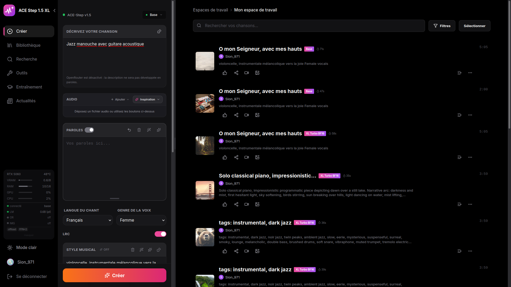
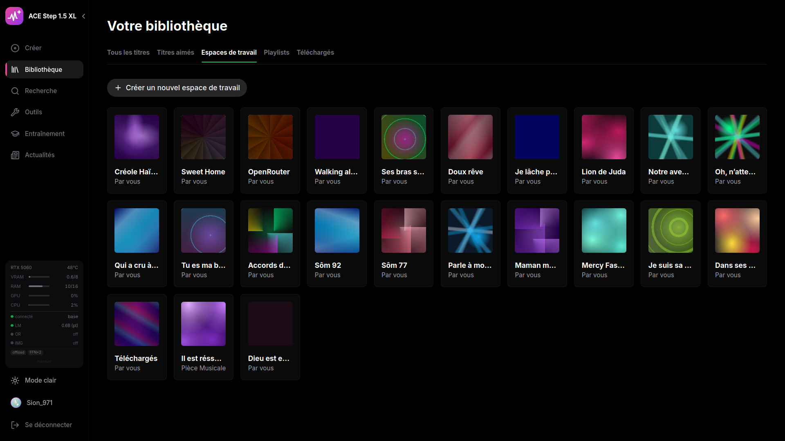
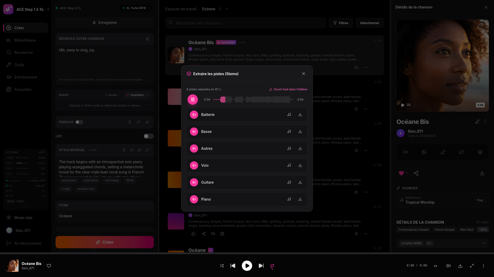
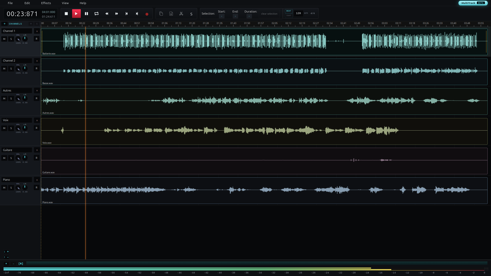
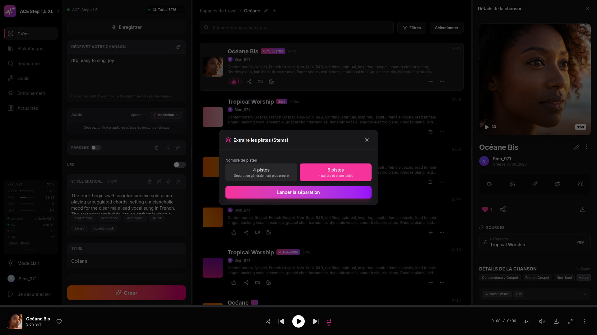
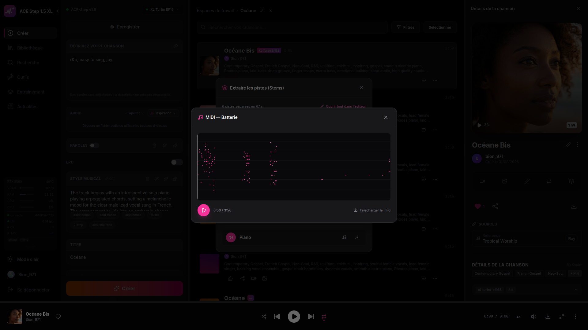
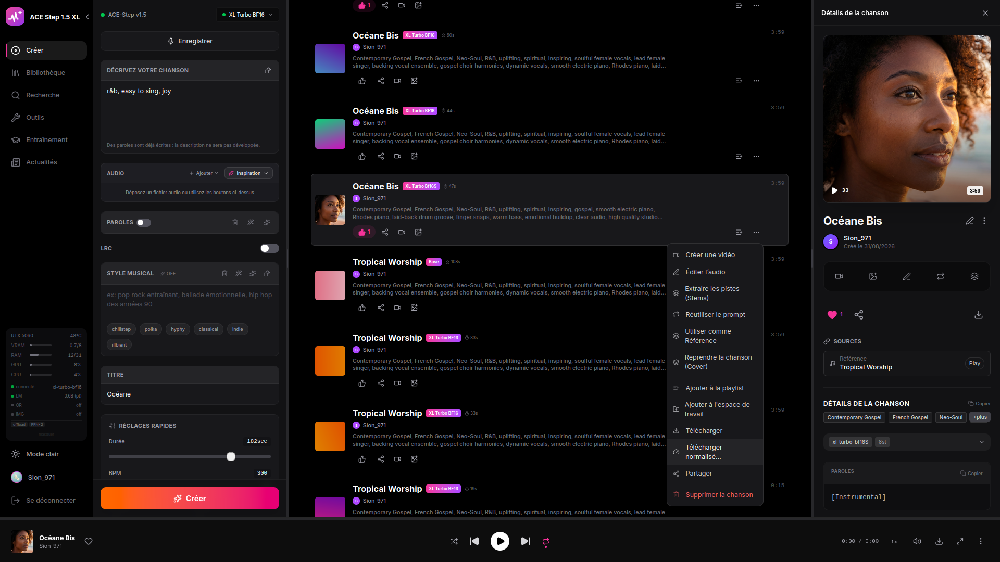
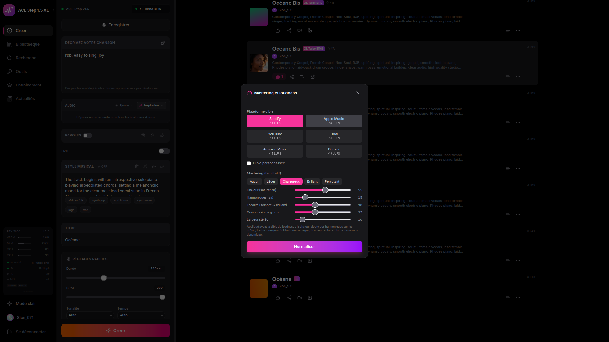
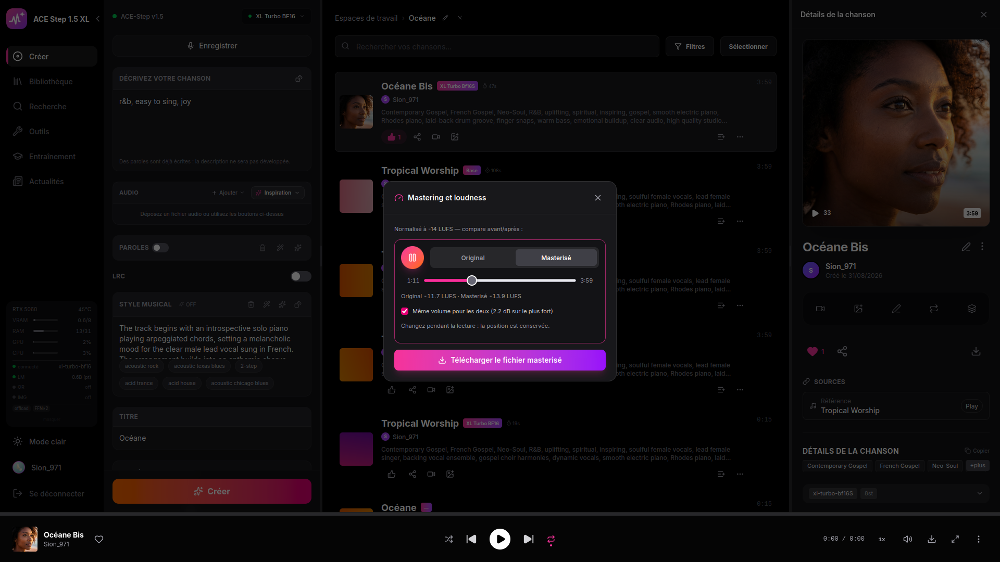

<p align="center">
  
</p>

<h1 align="center">ACE-Step Studio</h1>

<p align="center">
  <strong>A fork of ACE-Step Studio, built around a local AI music generation workflow</strong><br>
  <em>Powered by <a href="https://github.com/ace-step/ACE-Step-1.5">ACE-Step 1.5</a> — The Open Source AI Music Generation Model</em>
</p>

<p align="center">
  <a href="https://github.com/Sion971/ace-step-studio/stargazers"></a>
  <a href="https://github.com/Sion971/ace-step-studio?tab=MIT-1-ov-file"></a>
  <a href="https://github.com/Sion971/ace-step-studio/commits/master"></a>
</p>

---

## About this fork

This is a fork of [timoncool/ACE-Step-Studio](https://github.com/timoncool/ACE-Step-Studio), itself built on [AmbsdOP's ACE-Step UI](https://github.com/fspecii/ace-step-ui). It's been substantially reworked and extended — developed primarily on Linux Mint with an NVIDIA RTX GPU, with genuine Windows support built out in parallel rather than tacked on afterward.

Both platforms share the same underlying approach: a single [`uv`](https://github.com/astral-sh/uv)-managed Python environment instead of the older embedded-Python-plus-manual-pip setup most Windows installers still rely on. Same fast, reliable dependency resolution, same GPU-aware `flash-attn` handling, same isolated environment for MIDI conversion — one installer per platform, one consistent approach underneath. macOS isn't currently tested or supported.

**What's different from upstream:**

- **Playlists vs. Workspaces** — a real separation between curated playlists and working sessions, with exclusive workspace membership (a song lives in one workspace at a time) and a virtual "default" view computed by exclusion.
- **Stem separation, server-side** — [Demucs](https://github.com/facebookresearch/demucs) running in its own isolated environment, in 4 or 6 stems (adding guitar and piano). Synchronized playback with a per-stem mute, and no more browser RAM ceiling on the 6-stem model.
- **MIDI conversion, server-side** — [basic-pitch](https://github.com/spotify/basic-pitch) running in an isolated Python 3.11 environment (its TensorFlow dependency doesn't ship wheels for newer Python), converting stems to MIDI in seconds rather than tens of minutes in-browser, with a piano roll and built-in synthesizer to hear the result.
- **Mastering and loudness normalization** — optional mastering (warmth and harmonics, tone, glue compression, stereo width, with presets), then normalization to a streaming platform's LUFS target (Spotify, Apple Music, YouTube, ...) with two-pass `ffmpeg` loudnorm; compare the original and the result at the same volume before downloading.
- **AudioMass, updated and wired in** — upgraded to the multitrack build, with direct-load support: open a single stem or all of a song's stems together as separate tracks, straight from the browser, no manual export/import round-trip.
- **Runs on small graphics cards, down to 2 GB** — a *stream* mode keeps the model in RAM and sends it through the card one block at a time, then decodes the audio on the card. Measured on a GTX 1050 2 GB: a DiT step 12.7 s → 1.26 s, audio decoding 170 s → about 10 s, compared to the processor alone. Cards of 4 to 8 GB can choose between this mode and the normal one at install time. See [Which graphics card?](#-which-graphics-card).
- **LoRA training from the UI** — the full scan → label → preprocess → train pipeline, drivable from React without dropping into Gradio directly.
- **One installer per platform, both `uv`-based and GPU-aware** — detects your actual compute capability and compiler version, not just a menu choice, and knows when `flash-attn` will and won't build correctly for your hardware (Blackwell/RTX 50-series needs CUDA 12.8+ to compile it at all on Linux, or a matching prebuilt wheel on Windows — both installers check this before attempting work that's doomed to fail).

---

## 🎬 Screenshots

<p align="center">
  
</p>

<p align="center">
  <em>Generation panel, workspace view, and the bottom player — all in one screen.</em>
</p>

<table>
  <tr>
    <td width="50%"></td>
    <td width="50%"></td>
  </tr>
  <tr>
    <td align="center"><em>Workspaces, organized visually</em></td>
    <td align="center"><em>Stem extraction — WAV, MIDI, or straight to the editor</em></td>
  </tr>
</table>

<p align="center">
  
</p>

<p align="center">
  <em>All six Demucs stems, opened together as separate tracks in the AudioMass editor (Studio tab).</em>
</p>

### Stems, MIDI, mastering and loudness

<table>
  <tr>
    <td width="50%"></td>
    <td width="50%"></td>
  </tr>
  <tr>
    <td align="center"><em>Separate a song into 4 stems, or 6 with guitar and piano</em></td>
    <td align="center"><em>Piano roll with synthesizer playback, and a .mid download</em></td>
  </tr>
  <tr>
    <td width="50%"></td>
    <td width="50%"></td>
  </tr>
  <tr>
    <td align="center"><em>Stems and normalized download, one click from any song</em></td>
    <td align="center"><em>Optional mastering, then a streaming platform's LUFS target (or your own)</em></td>
  </tr>
</table>

<p align="center">
  
</p>

<p align="center">
  <em>One play button and an Original / Mastered switch that keeps the position, with the measured loudness of both and an option to play them at the same volume.</em>
</p>

---

## ✨ Features

### 🎵 AI Music Generation
| Feature | Description |
|---------|-------------|
| **Full Song Generation** | Create complete songs with vocals and lyrics up to 4+ minutes |
| **Instrumental Mode** | Generate instrumental tracks without vocals |
| **Custom Mode** | Fine-tune BPM, key, time signature, and duration |
| **Style Tags** | Define genre, mood, tempo, and instrumentation |
| **Batch Generation** | Generate multiple variations at once |
| **AI Enhance** | Enrich genre tags into detailed captions with proper BPM/key/time |
| **Thinking Mode** | Let AI reason about structure and generate audio codes |

### 🎨 Advanced Parameters
| Feature | Description |
|---------|-------------|
| **Reference Audio** | Use any audio file as a style reference |
| **Audio Cover** | Transform existing audio with new styles |
| **Repainting** | Regenerate specific sections of a track |
| **Seed Control** | Reproduce exact generations for consistency |
| **Inference Steps** | Control quality vs speed tradeoff |

### 🎤 Lyrics & Prompts
| Feature | Description |
|---------|-------------|
| **Lyrics Editor** | Write and format lyrics with structure tags |
| **Format Assistant** | AI-powered caption and lyrics formatting |
| **Prompt Templates** | Quick-start with genre presets |
| **Reuse Prompts** | Clone settings from any previous generation |

### 📁 Library Organization
| Feature | Description |
|---------|-------------|
| **Playlists** | Curated collections, a song can belong to several |
| **Workspaces** | Active working sessions — a song belongs to exactly one at a time |
| **Default View** | Everything not currently assigned to a workspace |
| **Bottom Player** | Full-featured player with waveform and progress |
| **Real-time Progress** | Live generation progress with queue position |
| **LAN Access** | Use from any device on your local network |

### 🛠️ Built-in Tools
| Feature | Description |
|---------|-------------|
| **Multitrack Audio Editor** | Trim, fade, and mix with AudioMass — open single stems or all of them together as separate tracks |
| **Stem Extraction** | Separate a song into 4 stems (vocals, drums, bass, other) or 6 (adding guitar and piano) with Demucs, server-side, with synchronized playback and per-stem mute |
| **MIDI Conversion** | Turn any stem into MIDI server-side, in seconds, with a piano roll and built-in synthesizer to hear it |
| **Mastering and Loudness** | Optional mastering (warmth, harmonics, tone, glue, width), then normalization to a streaming platform's LUFS target, with before/after listening at the same volume |
| **LoRA Training** | Full training pipeline, driven from the UI |
| **Video Generator** | Create music videos with Pexels backgrounds |
| **Covers** | Every song gets a procedural gradient cover, no internet needed. Optionally, an AI cover drawn locally after the audio is done (SDXL Turbo, NVIDIA GPU only, about 7 GB downloaded on first use); no cloud service is involved |

---

## 💻 Tech Stack

| Layer | Technologies |
|-------|-------------|
| **Frontend** | React 18, TypeScript, TailwindCSS, Vite |
| **Backend** | Express.js, SQLite, better-sqlite3 |
| **AI Engine** | [ACE-Step 1.5](https://github.com/ace-step/ACE-Step-1.5) (Gradio API) |
| **Audio Tools** | AudioMass (multitrack), Demucs, basic-pitch, FFmpeg |
| **Python tooling** | [`uv`](https://github.com/astral-sh/uv) — faster, more reliable dependency resolution than plain `pip`, same tool on both Linux and Windows |

---

## 📋 Requirements

| Requirement | Specification |
|-------------|---------------|
| **OS** | Linux (developed on Linux Mint / Ubuntu 24.04; Arch Linux also tested, in a container) or Windows 10/11 |
| **Node.js** | 22 LTS |
| **Python** | Managed automatically by `uv` — 3.12 on both platforms for the main environment; a separate isolated 3.11 environment on both platforms for MIDI conversion (and, on Linux, another for stem separation) |
| **NVIDIA GPU** | **From 2 GB of VRAM** (a GTX 1050 2 GB works: small-card *stream* mode, no language model). 4 GB and up: the 2B Turbo model. **8 GB** runs the XL Turbo model with the 0.6B language model (measured on an RTX 5060 8 GB). More VRAM leaves room for larger language models and longer tracks. See [Which graphics card?](#-which-graphics-card) below. No NVIDIA card at all: a CPU-only mode exists, but it is about 15 times slower than the length of the audio produced |
| **NVIDIA driver (Linux)** | **580 or newer** for the CUDA 13.0 stack (the default for RTX 20-series and newer); **525 or newer** for the older CUDA 12.x stacks; **570 or newer** for any RTX 50-series card. The installer reads `nvidia-smi`, suggests the newest stack your driver allows, and warns before installing if the driver is too old |
| **CUDA compiler (`nvcc`)** | Linux only, and only when `flash-attn` has to be compiled: on the CUDA 12.x stacks for RTX 30/40-series cards, or if a prebuilt wheel cannot be downloaded — `nvcc` must then support your card (the installer checks and falls back to SDPA if not). The CUDA 13.0 stack and RTX 50-series installs use a prebuilt wheel that is tested on your GPU after installation. Windows uses a prebuilt wheel too, no local compiler needed |
| **FFmpeg, libsndfile** | Installed automatically by the installer if missing |
| **uv** | Python package manager — installed automatically by both installers if missing |

### 🎮 Which graphics card?

The installer reads your card (`nvidia-smi`, then what PyTorch really sees) and chooses the model and the mode for you; you can always override them.

| Your card | What the installer chooses | Notes |
|-----------|----------------------------|-------|
| **3 GB or less** (e.g. GTX 1050 2 GB) | 2B Turbo, no language model, **stream mode** (automatic) | The processor keeps the model in RAM (about 3 GB for the 2B model); the card runs it block by block and decodes the audio. Pick the GPU option in the installer, not "CPU only". LoRA adapters work (not LoKr); AI covers need 6 GB or more. `STUDIO_SMALL_GPU=off` turns the mode off |
| **Over 3 GB, up to 6 GB** | 2B Turbo, no language model | Normal mode by default. On RTX 20-series and newer the installer also offers the stream mode (see below) |
| **Over 6 GB, up to 8 GB** (e.g. RTX 5060 8 GB) | XL Turbo BF16 on a card of 8 GB, 2B Turbo under that; 0.6B language model | **You choose, at install time, between the normal mode and the stream mode** (RTX 20-series and newer). Normal: the model is compressed to int8 and loaded on the card for each generation. Stream: no compression (bfloat16), blocks that fit stay on the card, about 10 GB of free RAM more (32 GB of RAM advised). Measured on an RTX 5060 8 GB, a 3-minute track: about 3 to 7 s of DiT in normal mode (plus 4 to 6 s to load and unload it), about 9 s in stream mode |
| **More than 8 GB** | XL Turbo BF16, language model on | Normal mode. ACE-Step recommends language models of 1.7B from 12 GB and 4B beyond 24 GB (the Studio does not change the language model by itself) |
| **No NVIDIA card** | CPU-only mode | Works, slowly (about 15 times the length of the audio) |

You can change the mode later without reinstalling: `./run.sh --mode normal` or `./run.sh --mode flux` (Windows: `run.bat --mode flux`). Details and measurements: `TROUBLESHOOTING.md` (sections 60 to 62).

---

## ⚡ Quick Start

### Linux

```bash
# 1. Clone this repo and ACE-Step-1.5 side by side (see full install below)
git clone https://github.com/Sion971/ace-step-studio.git
cd ace-step-studio

# 2. Run the installer — handles GPU detection, PyTorch, dependencies,
#    database migration, and the isolated MIDI conversion and stem
#    separation environments
./install.sh

# 3. Start everything (frontend + backend + AI engine) in one terminal
./run.sh
```

### Windows

```powershell
# 1. Clone this repo and ACE-Step-1.5 side by side (see full install below)
git clone https://github.com/Sion971/ace-step-studio.git
cd ace-step-studio

# 2. Run the installer — same idea as Linux, uv-managed Python throughout
install.bat

# 3. Start everything (frontend + backend + AI engine) in one terminal
run.bat
```

That's it — the UI opens automatically at `http://localhost:3001`.

---

## 📦 Installation

### 1. Get ACE-Step 1.5 (the AI engine)

```bash
git clone https://github.com/ace-step/ACE-Step-1.5.git
```

Place it alongside this repo — the launcher expects `../ACE-Step-1.5` relative to this project by default (configurable).

### 2. Clone this repo and run the installer

<details>
<summary><strong>Linux</strong></summary>

```bash
git clone https://github.com/Sion971/ace-step-studio.git
cd ace-step-studio
./install.sh
```

The installer walks through fourteen steps, all self-checking and safe to re-run:

1. System dependencies (FFmpeg, libsndfile) via apt or pacman (Arch), only if missing
2. Working directory structure
3. GPU detection (`nvidia-smi`: name, VRAM, compute capability, driver) with a suggested menu option — Enter accepts it. RTX 20-series and newer choose between CUDA 13.0 (suggested when your driver allows it) and CUDA 12.8; older cards (Pascal, Volta) use CUDA 12.6. Driver checks run before anything is installed. The VRAM tier sets the default model, recorded in `hardware_profile.env`, and Python virtual environment (via `uv`)
4. Build tools
5. PyTorch, matched to your selected CUDA version — 2.14.1 on the CUDA 13.0 stack, 2.11.0 on the others; the installer first checks that the PyTorch index actually offers that version
5b. NVIDIA NPP (a `torchcodec` runtime dependency that PyTorch doesn't pull in on its own) — skipped on the CUDA 13.0 stack, which doesn't need it
6. ACE-Step dependencies, including a real compute-capability check before attempting `flash-attn` — skips it cleanly (falling back to SDPA) rather than burning hours on a build that can't succeed on your hardware. Prebuilt wheels (CUDA 13.0 stack, RTX 50-series) are tested on your GPU after installation and removed if they do not run
7. `pytorch_wavelets` patch — works around a `pkg_resources` removal in modern `setuptools` that otherwise silently disables the optional DCW sampler correction
8. `torchcodec` load verification
9. Node.js check
10. npm install (frontend and server)
11. Frontend build
12. Database migration (playlist/workspace schema) — idempotent, safe on every reinstall
13. Isolated `basic-pitch` environment for MIDI conversion (Python 3.11 via the deadsnakes PPA on apt systems, via `uv` elsewhere, e.g. Arch)
14. Isolated Demucs environment for stem separation — delegates to `app/server/setup-demucs-venv.sh`, which creates `app/server/demucs-venv` (isolated from ACE-Step's pinned PyTorch/NumPy) and pre-downloads the 6-stem model so the first separation isn't slow. Skipped on re-runs if the environment already works; if it fails, the rest of the install still completes

To redo that environment on its own at any time:

```bash
cd app/server
./setup-demucs-venv.sh
```

</details>

<details>
<summary><strong>Windows</strong></summary>

```powershell
git clone https://github.com/Sion971/ace-step-studio.git
cd ace-step-studio
install.bat
```

The installer walks through thirteen steps, all self-checking and safe to re-run. It follows the Linux installer — one script, one menu — and replaces the former `install-blackwell-native.bat`:

1. Working directory structure
2. GPU detection (`nvidia-smi`: name, VRAM, compute capability, driver) with a suggested menu option — Enter accepts it. RTX 20-series and newer choose between CUDA 13.0 (suggested when your driver allows it) and CUDA 12.8; older cards (Pascal, Volta) use CUDA 12.6; AMD and Intel are pointed to ACE-Step's own scripts. Driver checks run before anything is installed
3. `uv` install (if missing)
4. Python 3.12 virtual environment (via `uv`), recreated from scratch on every run
5. PyTorch, matched to your selected CUDA version — 2.14.1 on the CUDA 13.0 stack, 2.11.0 on the others; the installer first checks that the PyTorch index offers that version for Windows, and afterwards that the CUDA build (not the CPU one) was installed
6. ACE-Step dependencies, `triton-windows`, and `flash-attn` — on the CUDA 13.0 stack a prebuilt wheel for RTX 30/40/50-series cards (no local compiler needed), tested on your GPU after installation and removed if it does not run; the other stacks use SDPA
7. `pytorch_wavelets` patch — same `pkg_resources` fix as Linux, same reasoning — and the `sitecustomize.py` warning filter
8. Node.js
9. npm install (frontend and server)
10. Frontend build
11. FFmpeg, downloaded automatically if missing, then a `torchcodec` load check
12. Database migration (playlist/workspace schema) — idempotent, safe on every reinstall
13. Isolated `basic-pitch` environment for MIDI conversion (Python 3.11), its own `uv`-managed venv to avoid a `tensorboard`/`tensorflow` version conflict with ACE-Step's own pin

If `torchaudio` fails to load with `Could not find module ... (or one of its dependencies)`, install the [Microsoft Visual C++ Redistributable](https://aka.ms/vs/17/release/vc_redist.x64.exe) — a very common missing piece for compiled Python extensions on a fresh Windows install, unrelated to this project specifically.

Server-side stem separation doesn't have a Windows setup script yet (planned).

</details>

Models download automatically on first run (~5GB).

### 3. Start the app

<details>
<summary><strong>Linux</strong></summary>

```bash
./run.sh
```

**Options:**

| Flag | Effect |
|------|--------|
| `--no-lm` | Skip the local 5Hz LM (0.6B) — frees ~1GB VRAM, good for LoRA training |
| `--gradio-only` | ACE-Step's own Gradio UI only (port 8001), no Express/React frontend — needed for dataset labeling |
| `--no-browser` | Don't auto-open a browser tab |
| `--port <n>` | Web server port (default 3001) |
| `--mode <normal\|flux>` | NVIDIA card of 4 to 8 GB (RTX 20-series and newer): choose the normal or the stream mode; the choice is saved |

</details>

<details>
<summary><strong>Windows</strong></summary>

```powershell
run.bat
```

Same flags as Linux (`--no-lm`, `--gradio-only`, `--no-browser`, `--port <n>`, `--mode <normal|flux>`).

</details>

---

## 🎼 Generation Modes

### Simple Mode
Just describe your song in natural language — genre, mood, instruments — and let ACE-Step handle the rest.

### Custom Mode
Fine-grained control over BPM, key, time signature, duration, and structure tags in your lyrics.

### AI Enhance & Thinking Mode
AI Enhance enriches short genre tags into detailed captions with proper metadata. Thinking Mode lets the model reason about song structure before generating audio codes — better results, more VRAM.

### Batch Size & Bulk Generation
Generate several variations of the same prompt in one pass to compare results quickly.

---

## 🔧 Built-in Tools

**Audio Editor (AudioMass, multitrack)** — trim, fade, apply effects. Open a single stem directly from your library, or send all of a song's stems over together as separate tracks in one editor session.

**Stem Extraction (Demucs)** — runs server-side in its own isolated environment (created by the Linux installer; no Windows equivalent yet). Separates into 4 stems (vocals, drums, bass, other) or 6 (adding guitar and piano) — 4 is generally cleaner, 6 is for when there's a real guitar or piano worth isolating. One play button starts every stem in sync, each stem has its own mute, and each can be downloaded, converted to MIDI, or sent straight to the editor.

**MIDI Conversion (basic-pitch)** — runs server-side in its own isolated environment, converts any stem to MIDI in seconds. A piano roll shows the notes and a built-in synthesizer plays them back; the `.mid` file can be downloaded.

**Loudness Normalization** — in a song's menu, **Télécharger normalisé…** adjusts the track to a platform's integrated-LUFS target using a two-pass `ffmpeg` loudnorm (measure, then apply an exact linear correction that preserves dynamics). Presets for Spotify, YouTube, Tidal, Amazon Music, Deezer and Apple Music, or a custom target. An optional mastering step runs first (soft saturation for warmth, high-frequency harmonics, tone, glue compression, stereo width, with Light, Warm, Bright and Punchy presets), so the target is reached on the mastered sound and a limiter holds the peak ceiling. Before/after listening uses one player with an Original / Mastered switch that keeps the position, shows both measured loudnesses and can play them at the same volume.

**LoRA Training** — scan your dataset, label, preprocess, and train, all from the UI.

**Video Generator** — turn a track into a music video with Pexels stock backgrounds.

---

## 🐛 Troubleshooting

| Issue | Solution |
|-------|----------|
| **ACE-Step not reachable** | Ensure Gradio server is running with `--enable-api` (handled automatically by the launcher) |
| **CUDA out of memory** | Set batch size to **1**, reduce duration, or disable Thinking Mode |
| **4GB GPU — Out of memory** | Batch size **1**, Thinking Mode **off**. The language model is off by default under 6 GB (the 0.6B model runs from 6 GB; larger ones need more). On RTX 20-series and newer, `./run.sh --mode flux` may help |
| **`flash-attn` build fails or errors at runtime (Linux)** | Check your `nvcc` version supports your GPU's compute capability — see `install.sh` step 6, or fall back to `--no-lm` if you just need generation working now |
| **PyTorch doesn't see the GPU (`torch.cuda.is_available()` is `False`) after the CUDA 13.0 stack (Linux)** | Your NVIDIA driver is too old for CUDA 13. Update it to 580 or newer, or re-run `install.sh` and choose the CUDA 12.8 stack. Check with `nvidia-smi`: its CUDA line (`CUDA Version`, or `CUDA UMD Version` on recent drivers) must show 13.0 or higher |
| **`install.sh` stops with « the PyTorch index does not offer torch X for cuYY »** | That stack is no longer published for that PyTorch version (the old CUDA 11.8 option, for instance, stopped at torch 2.7.1). Pick another stack in the menu |
| **Studio is slow or fails on a small GPU (6 GB or less)** | Cards of 3 GB or less use the stream mode by themselves. The default model is chosen from your VRAM when you run `install.sh` (2B Turbo and no language model below 8 GB). Re-run `install.sh` to regenerate `hardware_profile.env`, or set `DEFAULT_MODEL` in `ACE-Step-1.5/.env` — it always wins |
| **`torchaudio` fails to load with "Could not find module ... (or one of its dependencies)" (Windows)** | Install the [Microsoft Visual C++ Redistributable](https://aka.ms/vs/17/release/vc_redist.x64.exe) |
| **DCW disabled with a `pytorch_wavelets` warning** | Both installers patch this automatically (step 7 on Linux, step 5 on Windows) — if it's still happening, run `patch-pytorch-wavelets.py` manually against the relevant environment |
| **Songs show 0:00 duration** | Linux: `sudo apt install ffmpeg`. Windows: delete the `ffmpeg\` folder and re-run the installer |
| **LAN access not working** | Check firewall allows the port you're running on (default 3001) |

More detail in `TROUBLESHOOTING.md`.

---

## 🙏 Credits

- **[ACE-Step](https://github.com/ace-step/ACE-Step-1.5)** — the underlying open source AI music generation model
- **[timoncool/ACE-Step-Studio](https://github.com/timoncool/ACE-Step-Studio)** — the project this fork is built on
- **[AmbsdOP/ace-step-ui](https://github.com/fspecii/ace-step-ui)** — the original UI this was in turn based on
- **[@bdsqlsz](https://space.bilibili.com/29863478)** — Chinese localization, carried over from upstream
- **[AudioMass](https://github.com/pkalogiros/AudioMass)** — web audio editor
- **[Demucs](https://github.com/facebookresearch/demucs)** — audio source separation
- **[basic-pitch](https://github.com/spotify/basic-pitch)** — audio-to-MIDI conversion
- **[Pexels](https://www.pexels.com)** — stock video backgrounds

Built with [Claude](https://claude.ai) (Anthropic) as a development pair — most of this fork's Linux port, features, and this very README were worked through together, session by session.

---

## 🤝 Contributing

This started as a personal project to get ACE-Step Studio running well on Linux, and it's grown from there. Development happens in short, focused sessions rather than on a fixed schedule, so don't expect instant replies — but issues, questions, and pull requests are genuinely welcome. If something's broken, tell us. If you've got an idea, open a discussion. If you've fixed something yourself, a PR is very welcome.

---

## 📄 License

MIT License — see [LICENSE](LICENSE). Original copyright retained; this fork's changes are released under the same terms.

---

<p align="center">
  <em>Built on the shoulders of ACE-Step, AudioMass, Demucs, and everyone who worked on this UI before it got here.</em>
</p>
